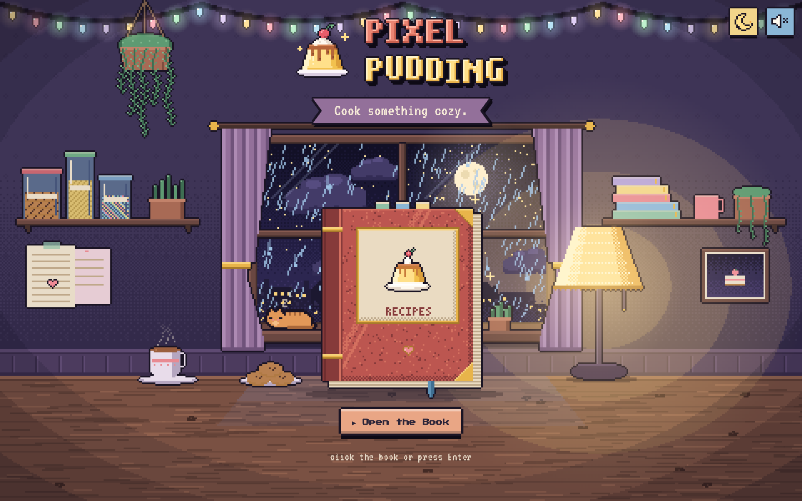
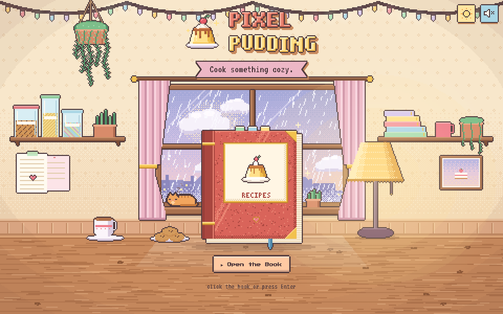
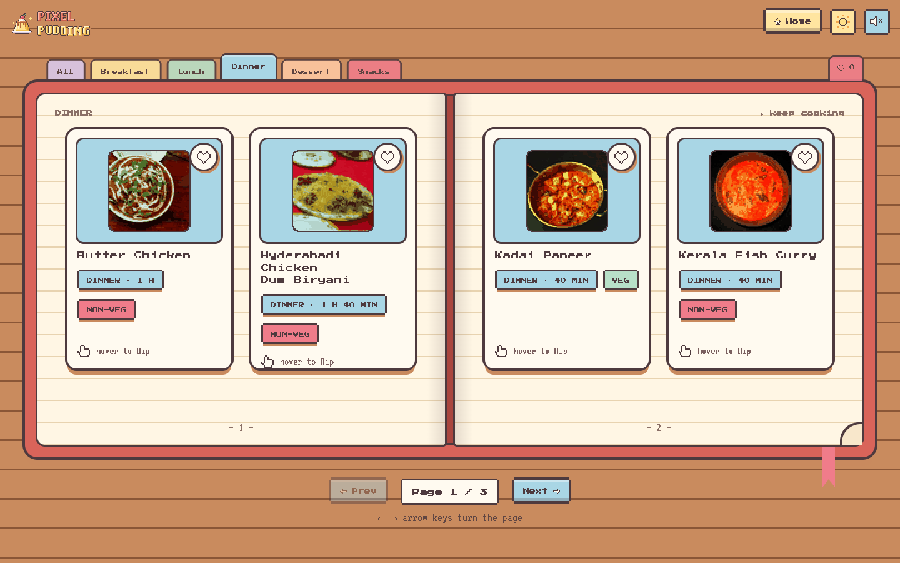
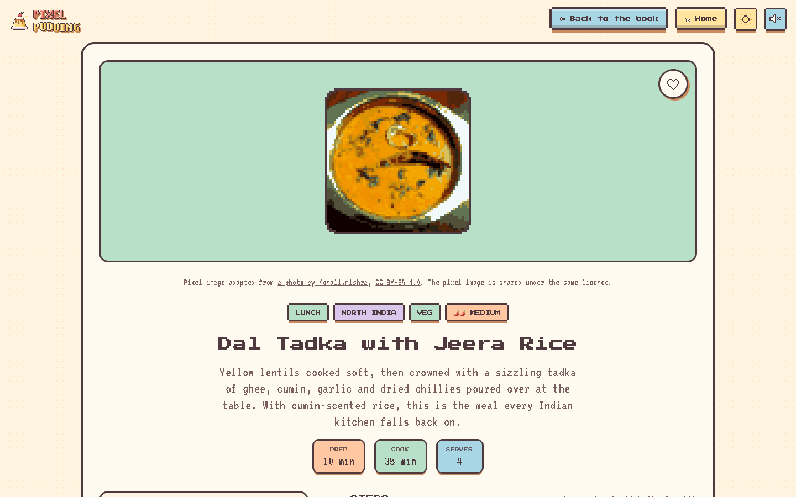
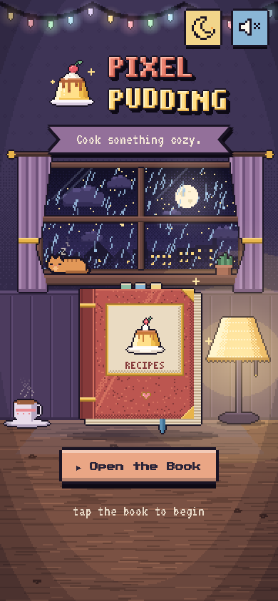

<div align="center">


### A cozy pixel-art recipe book

Indian home cooking and world comfort food, served in a rainy retro kitchen.

**React 19 · Vite 8 · Tailwind CSS 4 · Framer Motion · React Router 7**

</div>



## Features

**The kitchen** (`/`)
- A hand-built pixel-art scene drawn on canvas: rain on the window, drifting clouds, a sleeping cat, steaming tea, string lights
- Day and night versions with a smooth crossfade; follows your system setting and remembers your choice
- A lamp you can switch on and off, with lighting that changes the whole room
- Click the book (or press Enter) and it swings open and zooms into the recipe book

**The recipe book** (`/book`)
- A two-page spread on desktop, a single page on phones
- Bookmark tabs for Breakfast, Lunch, Dinner, Dessert and Snacks, plus a favourites tab
- Pages turn over the spine like a real book (← → keys work too)
- Flip cards with the ingredients on the back: hover on desktop, tap on touch, Enter/Space on keyboard
- Favourites saved in your browser

**Recipe pages** (`/recipe/:slug`)
- A servings scaler that recalculates every amount, with readable fractions (1½ cups, ¾ tsp)
- Tickable ingredients and steps
- Prep, cook and rest times, diet (veg / vegan / egg / non-veg) and spice level
- Allergen information: what the dish contains, hidden sources to check on labels, and allergy-friendly swaps
- "Back to the book" returns to the exact category and page you came from

**Everywhere**
- 44 recipes: 29 Indian (including egg dishes) and 15 world comfort-food classics
- Optional 8-bit sound effects (muted by default)
- Keyboard accessible, with visible pixel focus rings, and calmer motion for people who prefer reduced motion
- Works from 380 px phones up to wide desktops

| Day | Recipe book | Recipe | Phone |
| :-: | :-: | :-: | :-: |
|  |  |  |  |

## Getting started

You need [Node.js](https://nodejs.org) 22 or newer.

```bash
git clone <your-repo-url> pixel-pudding
cd pixel-pudding
npm install
npm run dev
```

Then open http://localhost:5173.

| Command | What it does |
| --- | --- |
| `npm run dev` | Start the development server with live reload |
| `npm run build` | Build the site into `dist/`, pre-render every page, and generate `sitemap.xml`, `robots.txt` and social preview images |
| `npm run preview` | Serve the production build locally |

## Project structure

```
src/
├─ pages/             Landing, Book, RecipePage, NotFound
├─ components/        PixelButton, RecipeCard, PageLeaf (page turn), CategoryTabs,
│                     Checklist, StepBubble, AllergyInfo, toggles, Header…
├─ pixel/             the pixel-art engine: raster, palettes, sprites, the kitchen scene
├─ context/           theme · sound · favourites
├─ data/              recipes (JSON) and photo credits
├─ lib/               recipe helpers (scaling, times, diets) and per-page SEO
└─ styles/            tokens.css (every colour, font and timing) · global.css
scripts/
├─ prerender.mjs      build-time HTML, sitemap and social images
├─ allergens.mjs      fills in each recipe's allergen information
└─ dish-photos/       turns photos into the pixel-art dish images
public/
├─ dishes/            pixel-art dish images (66 × 66)
└─ logo/              logo, icons and favicons
```

## Adding a recipe

Recipes live in `src/data/recipes-indian.json` and `src/data/recipes-world.json`. Copy an entry and edit it:

```jsonc
{
  "slug": "my-dish",            // URL: /recipe/my-dish
  "name": "My Dish",
  "category": "Dinner",         // Breakfast | Lunch | Dinner | Dessert | Snacks
  "cuisine": "Indian",
  "region": "Punjab",
  "diet": "veg",                // veg | vegan | egg | non-veg
  "spice": 2,                   // 0 mild … 3 hot
  "prepTime": 15,               // minutes
  "cookTime": 30,
  "restTime": 60,               // optional: soaking, marinating, chilling
  "servings": 4,
  "tag": "Weeknight · 45 min",
  "intro": "One or two sentences about the dish.",
  "ingredients": [{ "name": "onion, chopped", "amount": 1, "unit": "large" }],
  "steps": ["Do this.", "Then this."],
  "tips": ["Optional kitchen notes."],
  "readMore": ["Optional book recommendations."]
}
```

- `amount` must be a number (use `0.5` for ½) so the servings scaler can work.
- Then run `node scripts/allergens.mjs` to preview the allergen information and `node scripts/allergens.mjs --write` to save it. Check the result and edit the JSON by hand if needed.

## Dish images

Each dish image is a free-licensed photo from [Wikimedia Commons](https://commons.wikimedia.org), shrunk to 64 × 64 pixels and reduced to 16 colours.

To add or change one:

1. Add or edit the dish's entry in `scripts/dish-photos/picks.json`: the Commons file title, its licence, and a crop (`[centre-x, centre-y, size]` as fractions of the photo).
2. Run `python3 scripts/dish-photos/build.py` (needs Python 3 with [Pillow](https://pypi.org/project/pillow/)).

This writes `public/dishes/<slug>.png` and updates `src/data/photo-credits.json`. Each recipe page shows the credit that the photo's licence requires.

## Customising

- **Colours, fonts, timings:** `src/styles/tokens.css`. Light theme under `:root`, dark under `[data-theme='dark']`.
- **Scene colours** (sky, wood, lamp glow): `src/pixel/palette.js`
- **Fonts:** Press Start 2P and VT323 from Google Fonts, linked in `index.html`

## Deploying

1. Set your domain in `src/lib/useMeta.js` (`SITE`). Canonical links, the sitemap and social images use it.
2. Run `npm run build` and deploy the `dist/` folder to any static host (Netlify, Vercel, GitHub Pages, Cloudflare Pages).
3. Submit `https://your-domain/sitemap.xml` in Google Search Console.

## Credits and licences

- **Recipes:** original text, written for this project from traditional home-cooking methods.
- **Dish images:** pixel-art adaptations of photos from Wikimedia Commons. The photographer and licence for each one are listed in `src/data/photo-credits.json` and on its recipe page. Images adapted from CC BY-SA photos are shared under the same licence.
- **Fonts:** [Press Start 2P](https://fonts.google.com/specimen/Press+Start+2P) and [VT323](https://fonts.google.com/specimen/VT323) (SIL Open Font License).
- **Logo, kitchen scene and UI art:** drawn for this project.
